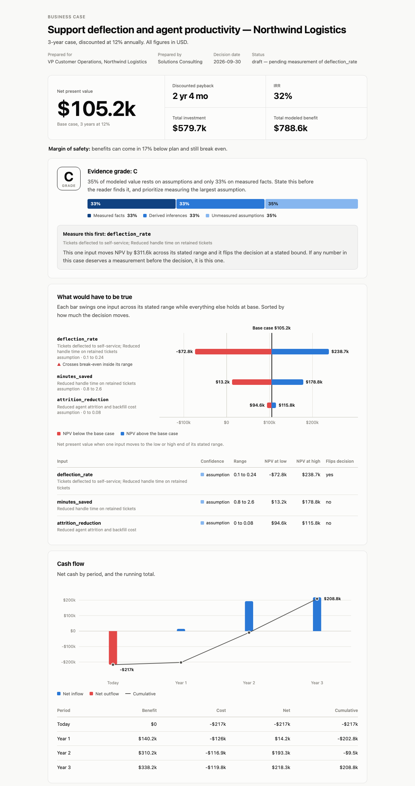

# gtm-skills

Business cases and go-to-market analysis with explicit assumptions and
reproducible Python calculations.

[](https://github.com/erickdronski/gtm-skills/actions/workflows/ci.yml)
[](LICENSE)


[Install](#install) · [Example](#see-it-work) · [Share it](#share-it) ·
[Assumptions](#the-assumption-ledger) · [Skills](#the-nine-skills) ·
[Engine](#the-engine)

Build business cases, prioritize accounts, assess deals, and plan go-to-market
investments with calculations a reviewer can inspect. **gtm-skills** combines
nine agent skills with **gtmkit**, a dependency-free Python library for financial
modeling, scoring, pricing, market sizing, and pipeline analysis.

The skills guide the analysis and communication. The engine calculates the
results. An **assumption ledger** records sources, distinguishes measured facts
from inferences and assumptions, and requires ranges for uncertain inputs.

**Start here:** [run the business-case example](#see-it-work),
[choose a skill](#the-nine-skills), or [inspect the engine](#the-engine).
The CLI also works without an AI agent or API key.

## Install

**The engine and the `gtmkit` command, with pip.** gtm-skills is not on PyPI;
pip installs it straight from this repository:

```bash
pip install git+https://github.com/erickdronski/gtm-skills
```

That installs the `gtmkit` package and command only. The skills stay in the
repository, so use the plugin or a clone below for those.

**As a Claude Code plugin** (recommended for the skills):

```bash
/plugin marketplace add erickdronski/gtm-skills
/plugin install gtm-skills
```

**Other agents, or to run the tests — clone the full repository:**

```bash
git clone https://github.com/erickdronski/gtm-skills
cd gtm-skills
python3 -m unittest discover -s tests -t .
```

No dependencies. No API key. Python 3.9+ and nothing else — the entire engine
is standard library, offline, and does not phone home.

Open the clone in your agent and ask it to read the relevant
`skills/<name>/SKILL.md`. Skill discovery varies by agent; reading the root
`AGENTS.md` alone does not load all nine skills. Keep `gtmkit/`, `skills/`, and
`examples/` together so the calculations and referenced resources are available.

Run the CLI from the repository root, or set the repository path when working
elsewhere (these shell examples use Bash or Zsh):

```bash
export GTM_SKILLS_ROOT="/absolute/path/to/gtm-skills"
PYTHONPATH="$GTM_SKILLS_ROOT" python3 -m gtmkit.valuecase \
  "$GTM_SKILLS_ROOT/examples/value-case/northwind-support-deflection.json"
```

In skill command examples, `${CLAUDE_PLUGIN_ROOT}` is the path supplied by
Claude's plugin installation. For a clone, replace it with `${GTM_SKILLS_ROOT}`
in both `PYTHONPATH` and resource paths, and quote paths that contain spaces.

**Individual skill copies are incomplete installs.** Tools such as
`npx skills add` copy the selected skill directories but omit the shared
repo-root `gtmkit/` engine and `examples/`. Use the full plugin or clone above
for the calculation workflows; an individual `SKILL.md` is not a standalone
package.

### The `gtmkit` command

`gtmkit` on its own lists every analysis with an example. `gtmkit <analysis>`
runs one with exactly the arguments `python3 -m gtmkit.<analysis>` takes, and
`gtmkit init` writes a starter spec to edit: a copy of a shipped example, which
it will not write over an existing file without `--force`.

```bash
gtmkit                                    # list the analyses
gtmkit init value-case --out case.json    # starter spec: value-case, deal, sizing
gtmkit valuecase case.json --check        # validate it
gtmkit valuecase case.json                # the markdown brief
```

In a clone without pip, `python3 -m gtmkit` run from the repository root is
the same command.

## See it work

From a clone, run the included example:

```bash
python3 -m gtmkit.valuecase examples/value-case/northwind-support-deflection.json
```

After a pip install, `gtmkit init value-case --out case.json` writes the same
spec and `gtmkit valuecase case.json` prints the same brief. Its headline and
evidence grade, with long lines wrapped here:

```
## Headline

| Metric                | Value                                                    |
|-----------------------|----------------------------------------------------------|
| Net present value     | $105.2k                                                  |
| Discounted payback    | 2 yr 4 mo                                                |
| IRR                   | 32%                                                      |
| Total investment      | $579.7k                                                  |
| Total modeled benefit | $788.6k                                                  |
| Margin of safety      | benefits can come in 17% below plan and still break even |

## Evidence grade: C

Grade C. 35% of modeled value rests on assumptions and only 33% on measured
facts. State this before the reader finds it, and prioritize measuring the
largest assumption.

- Measured facts: 33% of modeled value
- Derived inferences: 33%
- Unmeasured assumptions: 35%

**Measure this first — Tickets deflected to self-service, Reduced handle time on retained tickets / deflection_rate.**
This one input moves NPV by $311.6k across its stated range and it flips the
decision at a stated bound. If any number in this case deserves a measurement
before the decision, it is this one.
```

This is output from the included example, not a reported customer outcome.
The engine grades the declared evidence, identifies the input most worth
measuring, and reports whether its uncertainty could change the decision.
The example uses one deflection rate for both avoided tickets and handle time on
remaining tickets. Changing the rate updates both benefit streams.
It validates the structure and specificity of source descriptions; a reviewer
still needs to verify the underlying evidence.

## Share it

`--format html` writes the value case as one HTML file for a reader who will
never open the spec: the headline, the evidence grade, a tornado of every
ranged input, the cash flow, the value drivers and where the value comes
from, the floor case, the full assumption ledger and the cost lines. The file
has no JavaScript and no external fonts, images or stylesheets. It follows the
reader's light or dark setting, prints, and fits a phone screen. Its figures
come from the same code as the markdown brief, and every number a chart shows
is also written out as text or in a table.

```bash
python3 -m gtmkit.valuecase examples/value-case/northwind-support-deflection.json \
  --format html --out northwind.html
```



The screenshot is the top of the file that command writes, in the light theme.
After a pip install the same option works anywhere:
`gtmkit valuecase case.json --format html --out case.html`.

## The assumption ledger

Every number entering a model declares what kind of number it is:

| Kind | Means | Requires |
|------|-------|----------|
| `fact` | Measured, from a named artifact a reader could open | A specific source |
| `inference` | Derived from facts by stated reasoning | The derivation itself |
| `assumption` | Chosen, not measured | A rationale **and** a low/high range |

Assumptions require ranges so the engine can test how uncertainty affects
the result and expose the conditions needed for the case to hold.

Vague source descriptions are rejected during validation, including:

> `industry standard` · `research shows` · `best practice` · `internal data` ·
> a bare analyst-firm name · `estimated` · `TBD` · `assumed`

```
spec error: shared input 'deflection_rate': source for 'deflection_rate' reads as an
unfalsifiable claim: 'industry standard'. Replace it with a specific artifact
(a named export, dashboard, contract, or a stated derivation). If the number
really is unmeasured, mark it confidence='assumption' and give it a range.
```

Uncertainty stays visible in both the inputs and the report.

## The nine skills

| Skill | What it does |
|-------|-------------|
| [`value-case`](skills/value-case/SKILL.md) | Business cases with sensitivity analysis, a floor case, and an evidence grade |
| [`icp-scoring`](skills/icp-scoring/SKILL.md) | ICP definition and account scoring that reports data coverage alongside fit |
| [`campaign-plan`](skills/campaign-plan/SKILL.md) | Inverse funnel math — work backwards from the target, net of open pipeline, to required spend and volume |
| [`market-sizing`](skills/market-sizing/SKILL.md) | TAM/SAM/SOM with bottom-up and top-down reconciled against each other |
| [`pricing-strategy`](skills/pricing-strategy/SKILL.md) | Value metric, packaging, and Van Westendorp price sensitivity |
| [`positioning`](skills/positioning/SKILL.md) | Positioning and messaging hierarchy grounded in competitive alternatives |
| [`competitive-brief`](skills/competitive-brief/SKILL.md) | Battlecards a rep can survive a real objection with — including honest weaknesses |
| [`deal-qualification`](skills/deal-qualification/SKILL.md) | MEDDPICC scoring that separates confirmed from assumed, and pipeline coverage and forecasts from sourced stage probabilities |
| [`exec-comms`](skills/exec-comms/SKILL.md) | Board updates, QBRs, and decision memos that lead with the decision, with pipeline slides computed rather than typed |

Each skill includes its methodology, supporting references, and common
failure modes.

## Two ideas that run through everything

**Separate fit from evidence coverage.** Missing information should not be
interpreted as poor fit. The scorer reports both measures and holds
under-researched records out of the ranking:

```
| Record          | Tier    | Fit  | Coverage | Notes                                       |
|-----------------|---------|------|----------|---------------------------------------------|
| Northwind       | A       | 100% | 100%     | Fully covered.                              |
| Boreal Retail   | B       | 66%  | 100%     | Fully covered.                              |
| Halden Freight  | UNKNOWN | 83%  | 50%      | Not a low-fit record, an unresearched one.  |
| Marisol Shipping| OUT     | —    | 100%     | Below the volume where deflection pays back |
```

Halden scores 83% and is still held back. Ranking it above a fully-diligenced
peer would be comparing a measurement to a guess.

Deal qualification applies the same idea one level down. A CRM field records
what the rep believes; the deal engine also records how anyone knows it —
confirmed against a dated call or document, stated by a named person, assumed,
or never asked — and reports the two side by side:

```
## Verdict: BEST CASE on belief, AT RISK at the floor

Scores 61% across 88% of the rubric — BEST CASE on what the team believes.
38% of the rubric's weight is confirmed; 31% rests on someone's word, 19% on
the rep's assumption and 12% has not been asked.
```

The floor is every unconfirmed answer at its worst at once. The section after
the verdict names the one element whose answer would move the call, and why.

**Make limitations reviewable.** Evidence grades appear before driver detail,
floor cases accompany headline results, and pricing reports list rejected
survey responses. Reviewers can see which inputs need stronger evidence and
which conclusions depend on assumptions.

## The engine

`gtmkit` is the deterministic core. Each module is a CLI and an importable
library (after a pip install, `gtmkit <module>` runs the same command):

```bash
python3 -m gtmkit.valuecase case.json          # business case with sensitivity
python3 -m gtmkit.scoring --rubric r.json --records accounts.csv
python3 -m gtmkit.funnel --target-revenue 4000000 --acv 45000 --stage "mql:0.25"
python3 -m gtmkit.sizing --spec market.json    # bottom-up vs top-down
python3 -m gtmkit.pricing --responses survey.csv
python3 -m gtmkit.qualify deal.json            # MEDDPICC, confirmed vs assumed
python3 -m gtmkit.pipeline pipeline.csv --stages stages.json --target 1200000
```

Add `--format json` to any of them to build your own view on top;
`gtmkit.valuecase` also writes the HTML report described in
[Share it](#share-it).

Implementation details worth reviewing:

- **Period 0 is undiscounted**, per finance convention — which differs from
  Excel's `NPV()`, one of the most common errors in circulated models. Pinned by
  a test.
- **IRR returns `None` rather than a diverged number**, and flags cash flow
  shapes where IRR is mathematically ambiguous.
- **Van Westendorp validates monotonicity per respondent** and reports what it
  dropped, so invalid responses cannot silently distort the price-sensitivity
  curves.
- **Driver value is attributed across inputs by proportional sensitivity**, so
  the evidence grade discriminates between a case with one soft input and a case
  that is soft all the way through.
- **Formulas are evaluated by a whitelist AST walker, never `eval`.** These
  specs are routinely assembled from data an agent read out of an email or a
  PDF. That is untrusted input, and it is treated as such.
- **A "confirmed" MEDDPICC answer needs a source a reviewer could open** — a
  dated call, an email, a document. "Multiple conversations" is rejected the
  way "industry standard" is, and "she told me" is recorded as stated, with
  her name.
- **Pipeline coverage is reported next to the coverage your own stage
  probabilities require**, and the weighted forecast next to its standard
  deviation. Each stage probability is a ledger entry; a CRM picklist default
  declared as a measured fact is refused.

## Testing

```bash
python3 -m unittest discover -s tests -t .
python3 tools/validate_skills.py             # lint every skill
```

The finance tests check against hand-computed closed-form values rather than
snapshots — a snapshot test would have happily locked in the off-by-one
discounting error those tests exist to prevent. The skill linter checks
frontmatter, description trigger quality, dead links, referenced modules and
the flags their commands use, and length budgets, and runs in CI.

## Contributing

Work in sales, marketing, or value engineering? A concrete counterexample to a
skill's advice is a useful contribution, even without code. Python contributors
can help reproduce calculation questions; documentation contributors can clarify
an example they have tried.

[Choose a first contribution](CONTRIBUTING.md#make-a-first-contribution).
The quality bar stays the same: anything producing a number needs a test, and
claims about how business works should say what would make them wrong.

## Related

Part of a set of small, standalone tools for working with coding agents:

| Tool | Job |
|---|---|
| [agentsmith](https://github.com/erickdronski/agentsmith) | Derives your AGENTS.md from the repo and detects drift |
| [contexttest](https://github.com/erickdronski/contexttest) | A/B tests whether an AGENTS.md change actually helps |

## License

MIT. Use it commercially, fork it, ship it inside your product.
